# Model

Mijn Digitaal tuintje: www.jjk-enterprise.nl

Het staat model voor digitale tuintjes welke bij 'Het web is voor iedereen' door studenten worden gemaakt.

## Inhoudsopgave

- [Maandag 31 aug Kickoff](#maandag-31-aug---kickoff)
- [Woensdag 2 sept Sprint 0](#woensdag-2-sept---sprint-0)
- [Vrijdag 4 sept Sprint 0](#vrijdag-4-sept---sprint-0)
- [Maandag 7 sept Sprint 1](#maandag-7-sept---sprint-1)
- [Dinsdag 8 sept Sprint 1](#dinsdag-8-sept---sprint-1)
- [Woensdag 9 sept Sprint 1](#woensdag-9-sept---sprint-1)
- [Donderdag 10 sept Sprint 1](#donderdag-10-sept---sprint-1)
- [Vrijdag 11 sept Sprint 1](#vrijdag-11-sept---sprint-1)
- [Maandag 14 sept Sprint 1 (Bi-Weekly Geek)](#maandag-14-sept---sprint-1)
- [Woensdag 16 sept Sprint 1](#woensdag-16-sept---sprint-1)
- [Vrijdag 18 sept Sprint 1 (Retrospective)](#vrijdag-18-sept---sprint-1)
- [Maandag 21 sept Sprint 2](#maandag-21-sept---sprint-2)
- [Dinsdag 22 sept Sprint 2](#dinsdag-22-sept---sprint-2)
- [Woensdag 23 sept Sprint 2](#woensdag-23-sept---sprint-2)
- [Donderdag 24 sept Sprint 2](#donderdag-24-sept---sprint-2)
- [Vrijdag 25 sept Sprint 2](#vrijdag-25-sept---sprint-2)
- [Maandag 28 sept Sprint 2 (Bi-Weekly Geek)](#maandag-28-sept---sprint-2)
- [Woensdag 30 sept Sprint 2](#woensdag-30-sept---sprint-2)
- [Vrijdag 2 okt Sprint 2 (Retrospective)](#vrijdag-2-okt---sprint-2)
- [Maandag 5 okt Sprint 3](#maandag-5-okt---sprint-3)
- [Dinsdag 6 okt Sprint 3](#dinsdag-6-okt---sprint-3)
- [Woensdag 7 okt Sprint 3](#woensdag-7-okt---sprint-3)
- [Vrijdag 9 okt Sprint 3](#vrijdag-9-okt---sprint-3)
- [Maandag 19 okt Sprint 3](#maandag-19-okt---sprint-3)
- [Woensdag 21 okt Sprint 3 (Bi-Weekly Geek)](#woensdag-21-okt---sprint-3)
- [Vrijdag 23 okt Sprint 3 (Retrospective)](#vrijdag-23-okt---sprint-3)
- [Maandag 26 okt Sprint 3](#maandag-26-okt---sprint-3)
- [Bronnen](#bronnen)

# Learning Log

## Maandag 31 aug - Kickoff 

### Proces

Een fork van de model repository gemaakt en gepubliceerd via mijn eigen Github omgeving.

We hebben een zelftest gemaakt zodat we weten wat voor deepdives we kunnen doen zodat we voorbereid zijn op alles

### Checkout

#### Leg uit wat een source hosting platform is en voor welke jij gekozen hebt.

Een source hosting platform is een platform waar je codes die je hebt geschreven kan bewaren en delen met de community. Ik heb gekozen voor Github

#### Vertel welke domeinnaam jij gekozen hebt en hoe je die hebt gekoppeld aan jouw pagina.

Ik heb de naam JJK-Enterprise gekozen omdat die nog beschikbaar was en ik heb die gekoppeld door via github de domein naam met DNS te valideren alleen is het nog niet gelukt.

#### Beschrijf hoe je aanpassingen aan jouw pagina kunt maken en hoe je er voor zorgt dat die op het web gepubliceerd worden.

Ik kan aanpassingen maken aan mijn pagina via VSCodium omdat ik via de github de https link heb gecloned aan de VSCodium en daarna synchronized.

## Woensdag 2 sept - Sprint 0

### Deepdives 1e dag

### Deepdive - Interactie: MMD, micro-interacties, forms

Ik heb een begin gemaakt van de wok-to-walk op figma door na te denken welke stappen je moet doorlopen als je een menu digitaal maakt.

### Deepdive - Schetsen van o.a. interactie en animatie

We hebben een schetscursus gehad waar we leren om rechte lijnen te schetsen zonder liniaal en vierkanten te tekenen en een grid te maken.
Om uiteindelijk een wireframe te maken die de animaties laat zien.

## Vrijdag 4 sept - Sprint 0

### Deepdives 2e dag

### Deepdive - Praktische CSS

We moesten een lelijke website mooier maken door een artikel te schrijven met wat componenten die vooraf werd gegeven.
De voorbereiding was eerst een lelijke website maken.

### Deepdive - CSS: fonts met kleur en effecten

Voor de voorbereiding moesten we eerst een stukje tekst na maken door er een font aan toe te voegen en kleur aan de eerste letter van de tekst
en we moesten bij CSS Diner game naar bij level 14 komen.

Daarna in de les moesten we bij twee quotes css toevoegen zodat het dan op de voorbeeld gaat lijken

## Maandag 7 sept - Sprint 1

### Proces

We hebben allemaal een artikel gelezen die gaan over de digital garden.
En ik koos voor de 3 kleine artikels om te lezen en heb tijdens het lezen belangrijke informatie opgeschreven.
We hebben tactieken gebruikt hoe je een website snel kan scannen en beter begrijpend te lezen.

We hebben 2 websites uitgekozen om te analyseren of ze 'webby' zijn. door te kijken naar 6 verschillende punten.

ik had gekozen voor deze 2 websites:
https://melonland.net/
https://jen.dev/

En had het kort geanalyseerd.

En daarna gingen we bespreken in groepjes van 4 welke het meest webby is en welke het minst.

Dus voor ons was het meest webby: https://nuel.pw/
en het minst webby: https://sixey.es/

### Checkout

#### Leg uit wat een digital garden is en waarom dat anders is dan een reguliere website.

De digital garden is een website waar je je eigen ideeën kan publiceren en door andere kan laten bekritiseren. En daarmee beetje bij beetje steeds beter te maken of meer uit te proberen. en bij een reguliere website hoort het al compleet aangeleverd te zijn en is minder open voor kritiek.

#### Leg uit wat een website 'webby' maakt en welke websites jou het meeste inspireren.

Een website is 'webby' wanneer het voldoet aan de volgende eisen: Fluïde, adaptief, interactief/dynamisch, toegankelijk, volwassen, expressief, leuk/verassend.
Bij mij inspireert een website het meest als ze interactief, expressief en verassend is.

#### Vertel waar jij mee aan de slag wilt gaan bij het maken van jouw eigen digital garden (let op: dit zijn jouw eerste ideeën, dit kan en mag veranderen in de loop van het programma.)

Ik wil aan de slag gaan met films. En specifiek over films die me fascineren en inspireren.

## Dinsdag 8 sept - Sprint 1

### Proces

Ik heb een HTML presentatie gemaakt door Markdown te gebruiken. en heb dus 10 links verzamelt die best interessant allemaal een eigen functie hebben, maar wel releteerbaar is met films of webby.

### Deepdive - Light & Dark theme

Ik heb hier geleerd hoe ik een basic custom light and dark background kan gebruiken. Dus ik ga dat nu ook al implementeren in mijn eigen website, maar ik ga het met een gradient background doen.

Ik heb ook geleerd hoe ik foto's kan afwisselen per thema light of dark. Daarmee kan ik een light/dark switch maken en ik heb al een idee hoe.

## Woensdag 9 sept - Sprint 1

### Proces

We hebben een sfeer woord bedacht voor ons thema en daarmee foto's gezocht die we zelf hebben gemaakt of van het internet en van deze foto's hebben we een abstracte vertaling gemaakt naar een typo graphic. En daar hebben we er 4 uit van gekozen en dat gebruikt ter inspiratie voor de crazy 8.

### Checkout

#### Leg uit waar het Visual Research in 3 stappen naartoe werkt

1. Van eerst het gevoel beschrijven

2. Naar de abstracte vertaling te maken.

3. tot slot door zelf ideeën te genereren.

#### Vertel in 2 zinnen waar jouw Garden over gaat, en met welke content je dat gaat doen (beeld, tekst, sound, animatie enz).

Het gaat over hoe je jezelf kan herkennen in films en er kan inleven. En hoe het je kan inspireren.

#### Vertel kort welk idee van de Crazy 8 je het liefst zou willen uitvoeren/ verder zou willen onderzoeken.

Ik zou het liefst het idee met de dvd speler en de discs uitvoeren/ verder onderzoeken.

## Donderdag 10 sept - Sprint 1

### Deepdive - Mooie kleuren en gradients

Ik weet nu hoe alle soorten gradients werken en hoe je meerdere tegelijk kan gebruiken maar ook hoe je percentages kan gebruiken om een positie aan te geven.

Ik ga gradients gebruiken voor mijn achtergrond en ik ga de gradients in een light & dark custom property zetten.

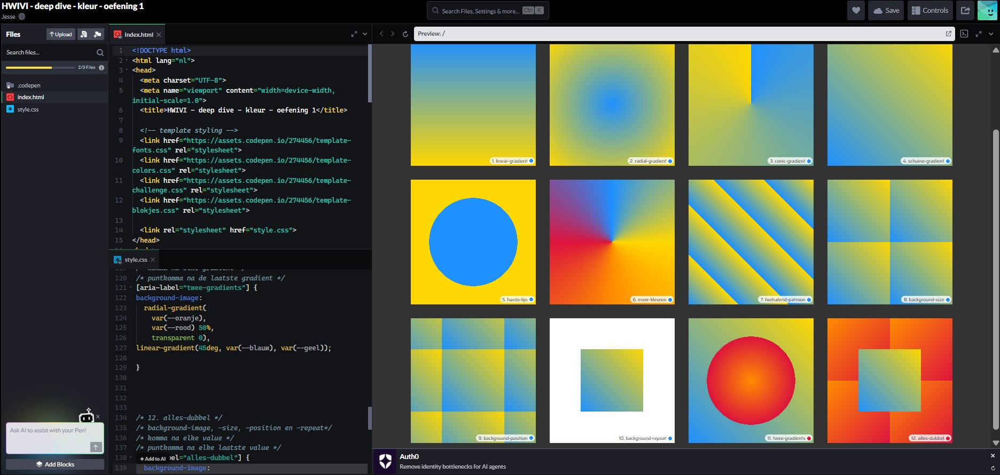
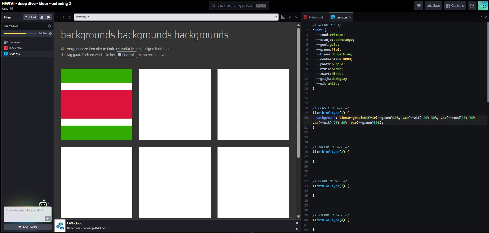
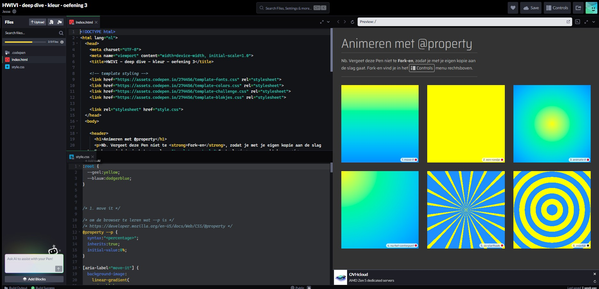

## Vrijdag 11 sept - Sprint 1

### Proces

Ik heb in illustrator een dvd speler gemaakt omdat ik een soort nostalgisch gevoel wil creeëren die iedereen wel herkent.
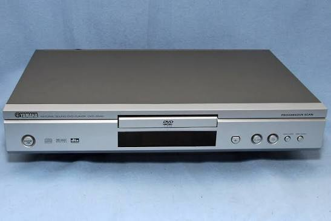

Uiteindelijk heb ik dit allemaal gecreeërd in illustrator en heb er SVG's van gemaakt zodat het geen achtergrond met zich mee brengt. En heb het als in Images in mijn website geïmplementeerd
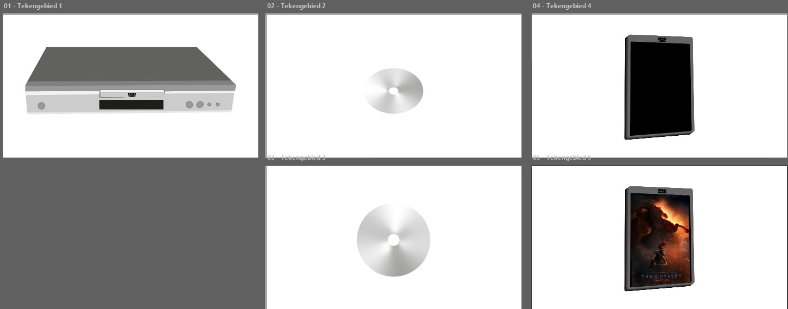

### Deepdive - Grid 101 + Media queries

Ter voorbereiding moest ik oefeningen doen die mij ging helpen met het begrijpen van de grid code's.

Daarna kregen wij de deepdive van Sanne en hebben we meer geleerd over hoe je grid goed kan gebruiken voor je eigen website.

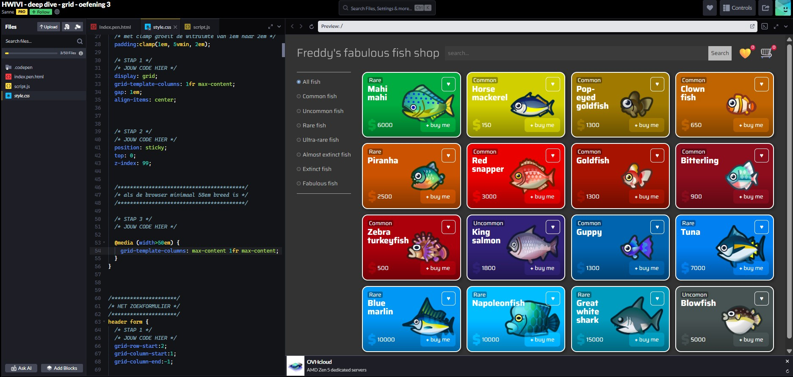

### Checkout

#### Welke feedback heb je gehad?

Van Barbara kreeg ik te horen dat ik het niet te moeilijk moet willen en dat ik meer een soort gevoel kan creeëren en niet te breed moet willen denken.

## Maandag 14 sept - Sprint 1

### Bi-Weekly Geek

We hebben de Bi-weekly geek gehad. Daar hadden we een wooclap vragenlijst beantwoord. En daarna hadden we een vel op onze tafel met een van de vragen die gesteld was. En daarmee moesten we zelf deelvragen bedenken die belangrijk waren om een beter antwoord te kunnen geven op de hoofdvraag. Daarna kregen we een ander vel met al de deelvragen bedacht en daarmee moesten we samen nadenken welke onderzoeksmethode we ervoor zouden kunnen toepassen om op een duidelijk antwoord te komen.

### Checkout

#### Leg uit wanneer een website 'lelijk' wordt en geef voorbeelden wat je kan doen om deze 'lelijke' onderdelen te fixen?

Wanneer het niet meer werkt en geen overzicht heb van wat het probleem is. inspecteren en in de console kijken wat het probleem is.

#### Vertel welke volgende stap je neemt om je website responsive te maken.

Een goeie grid display maken met fractions. die deze code gebruiken: grid-template-columns: repeat(auto-fit, minmax(20em, 1fr));

#### Kun je het ontwerp en de bouw van je eigen Garden (zo uit je hoofd) onderbouwen in Webby vocabulair?

Ja ik ken alle webby vocabulair aspecten uit mijn hoofd dus weet goed te onderbouwen wat er wel en niet goed aan is. Alleen heb ik nog niet het ontwerp af om het nu te kunnen doen.

### Deepdive - Responsive grid + Grid-areas

Ik heb geleerd hoe je grid areas kan gebruiken om snel aan te geven waar alles moet staan en te spelen met media queries om een beter responsive website te maken met meer variaties in hierarchie.

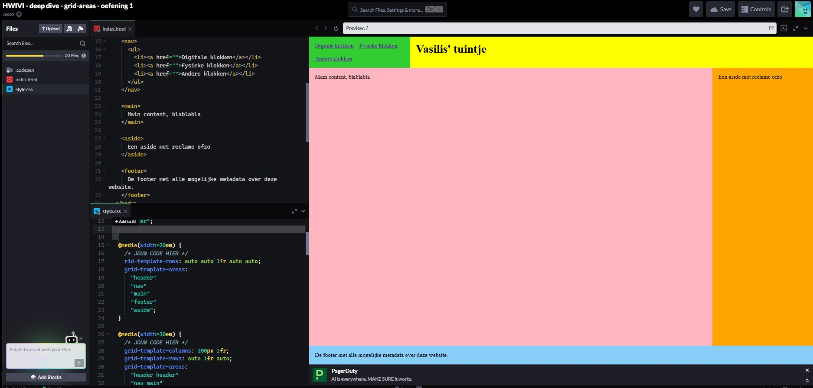
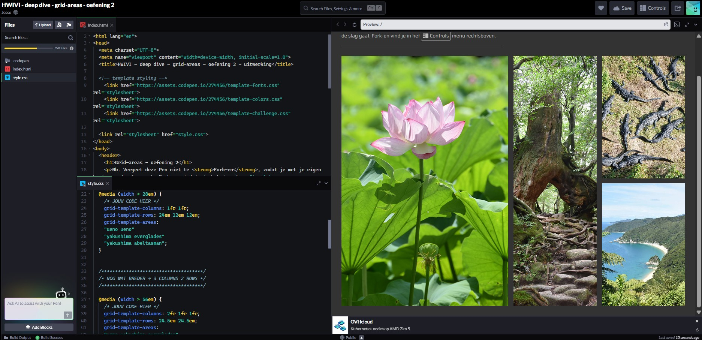
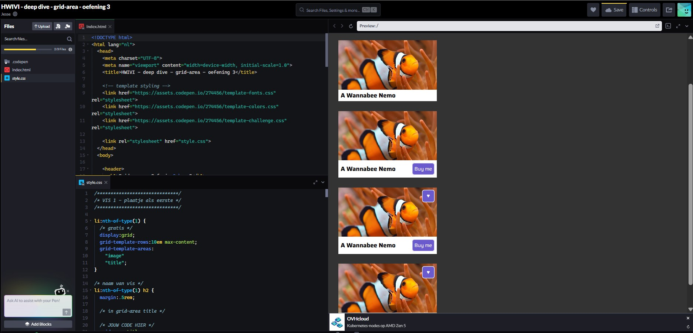

## Woensdag 16 sept - Sprint 1

### Proces

We hebben onze huidige status van de digital garden nagetekent.

En daarna kreeg ik een schets van degene naast mij hoe ik het contrast kan verbeteren.

### Checkout

#### Noem 3 Gestalt- of Design principes op en laat de ander uitleggen wat ze betekenen en doen.

Balans - Evenwichtig van elkaar. Dus aan beide kanten is het niet gespiegeld als bij symmetrie

Symmetrie - Beide kanten is hetzelfde. deze zie je vaker terug komen in designs.

Herhaling - hetzelfde blijft steeds terug komen.

#### Een grid biedt ruimte om te spelen (vrijheid), maar tegelijkertijd ook eenheid en structuur (vastigheid). Wat wordt hiermee bedoeld?

hoe meer columns en rows hoe meer mogelijkheden maar het lijn talles ook uit waardoor het toch een structuur heeft.

#### Welk principe neem je mee in een laatste iteratie van je eigen Garden?

De balans van de grid.

## Vrijdag 18 sept - Sprint 1

### Retrospective

We waren bezig met de retrospective

### Feedback

Daarna ging ik op gesprek met Vasilis en kreeg ik feedback

## Maandag 21 sept - Sprint 2

### Proces

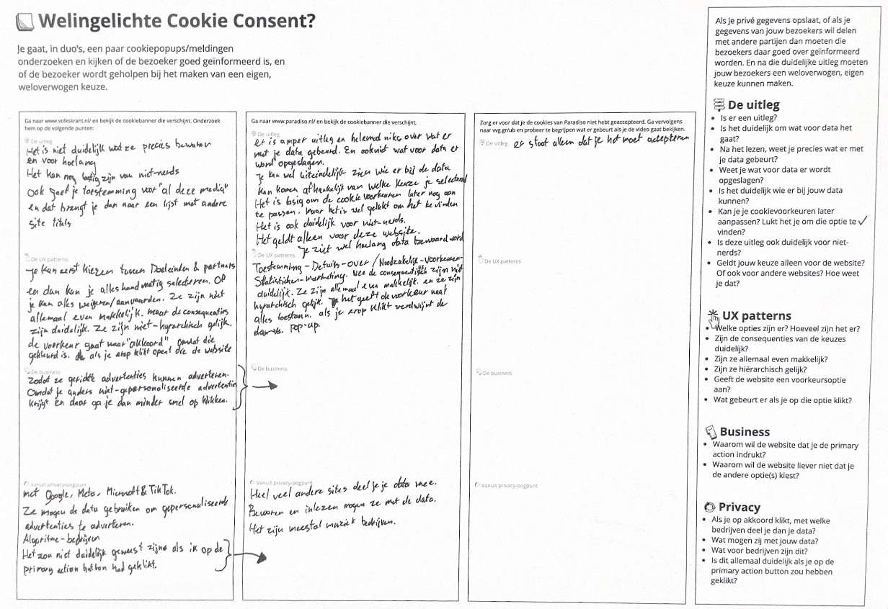
We zijn erachter gekomen dat je de video van paradiso helemaal niet kan afspelen tenzij je de cookies accepteert maar ze zeggen helemaal niks qua wat je nou precies accepteert. En bij de volkskrant staat veel uitleg en wat meer old school. Bij paradiso staat ook uitleg maar nog niet heel duidelijk, maar wel moderner.

### Checkout

#### Wat zijn HTML landmark role elements?

Dat zijn de speciale elements die tussen <> in zitten en allemaal nog een aparte functie eraan hebben (of niet).

#### Wat zijn heading elementen en hoe horen deze 'genest' te worden?

Dat zijn alle titel groottes en die kan je nesten door bijvoorbeeld:
in de
header {
font-family: sans-serif;
h1 {
color: white;
}
}

dus je doet een element in de andere element die eigenlijk een kind is van dat element

## Dinsdag 22 sept - Sprint 2

### Deepdive - Buttons, states en selectors 

Ik heb de deepdive gedaan als huiswerk en ik neem mee ik hoe de kleuren een bepaalde naam kan geven in mijn code.

## Woensdag 23 sept - Sprint 2

### Proces

1. Bespreek in jouw groepje welke gegevens op jouw digital garden van gebruikers verwerkt worden. Houdt daarbij in de gaten welke diensten je allemaal gebruikt. Zelfs als je alles zelf geschreven hebt zijn dat er al twee: GitHub pages hosting én het digitaaltuintje component.

De diensten die ik gebruik is dus de Webring en Github pages hosting

2. Informeren van gebruikers is een plicht die je hebt als websitemaker: Hoe kan je gebruikers informeren over het gebruik van hun gegevens op jouw website?

Je kan een pop-up scherm hebben als je de website in het begin opent en daar informatie op zetten en hun de keuze geven of ze daarmee akkoord gaan voordat alles in werking gaat.

3. Op welke manier kan je instemming vragen? Doe desk-research en zoek tenminste 10 verschillende manieren van het vragen van consent op het web.

- Over het hele scherm en als je pas accepteert kan je de website gebruiken
- Je kan het pas aanvinken als je alles 'gelezen' hebt.

4. Denk na over een manier van werken die past binnen de layout van jouw digital garden?

Het zou leuk zijn als ik een oude bioscoopticket gebruik als cookie pop up en dat als je op accepteer klikt dat dan een gedeelte van je ticket wegvalt.

We hebben allemaal naar een website moeten kijken waar dark patterns te vinden zijn. en ik kwam met het idee om op Booking.com te kijken. Daar zag ik dat het moeilijk was om je privacy instellingen te wijzigen. Dus ik had daar een ux wireflow van getekent.

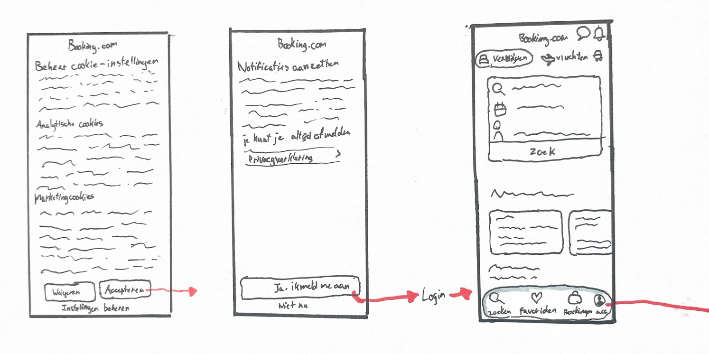
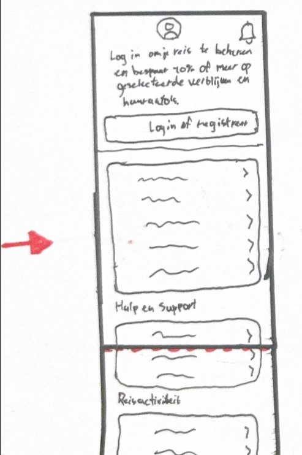

### Checkout

#### Wat is een wireflow en wat heb je er aan?

een wireflow kan heel goed laten zien hoe je van de ene scherm naar de andere scherm gaat door een bepaalde actie uit te voeren. het laat alle essentiele elementen zien en de plaatsing ervan en het helpt je om te ontdekken hoe goed het flowt zonder te veel moeite erin te stoppen. Zo kan je verschillende wegen proberen.

#### Wat zijn dark UX patterns? Geef drie voorbeelden...

Dat zijn patronen die jou als consumer kan misleiden, manipuleren of je überhaupt gewoon tegenwerken (zonder dat je het door hebt).

Confirmshaming: De weiger-knop krijgt een pijnlijke of schuld-opwekkende tekst

Roach Motel: Het is heel makkelijk om ergens lid van te worden, maar bijna onmogelijk om het op te zeggen.

Hidden costs: Extra kosten pas laten zien in de allerlaatste stap van het afrekenen

#### Waar moet je als ontwerper rekening mee houden bij het maken van een human consent component?

Met hoe duidelijk alles is. Transparant zijn met alles. En het moet makkelijk terug te vinden zijn als je iets wilt aanpassen. en toegankelijk voor iedereen.

## Donderdag 24 sept - Sprint 2

### Deepdive - Buttons + Dialogs

Ik heb geleerd hoe je buttons kan gebruiken om een funtie aan te roepen van je js bestand om de body een class te geven en daarmee iets laten gebeuren. Zoals een verandering of animatie. Ik ga dit gebruiken om mijn dialog beter te maken.

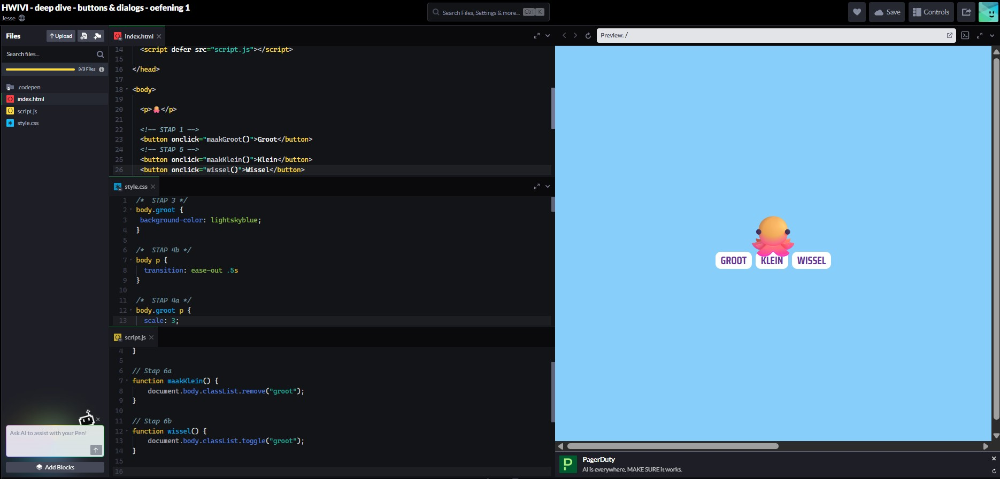

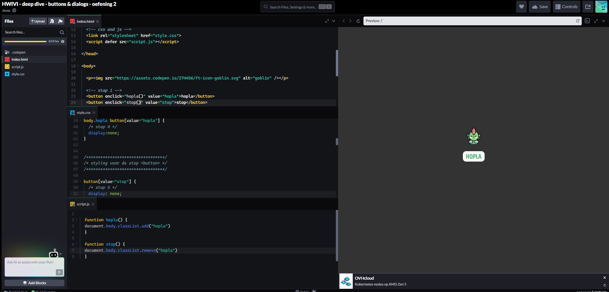

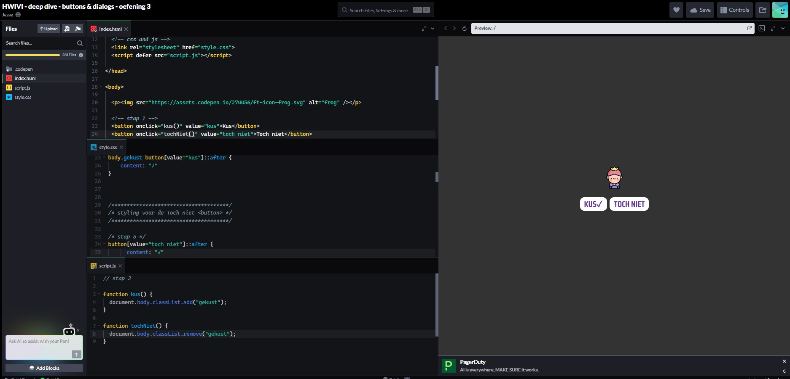

## Vrijdag 25 sept - Sprint 2

### Deepdive - Position + Dialogs

Deze deepdive heeft mij geholpen om meer variatie qua plaatsing in mijn eigen website te implementeren.

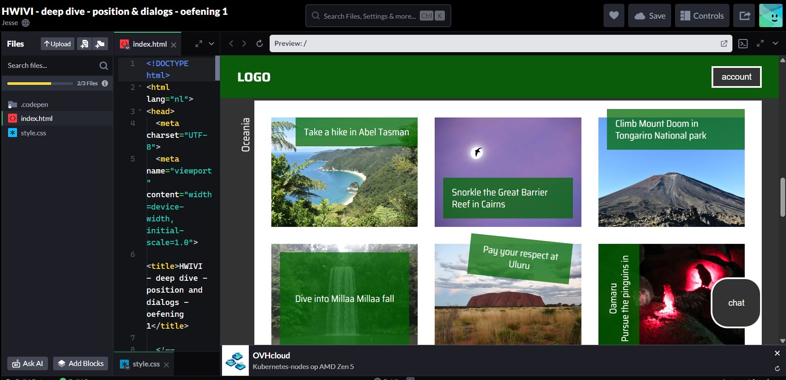

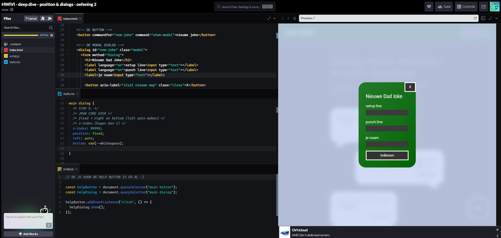

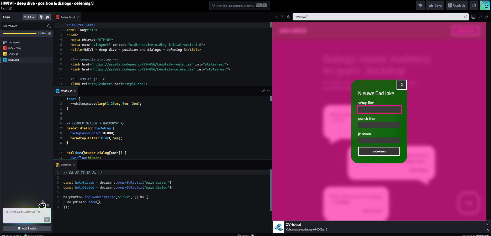

### Checkout

#### Wat heb je geleerd?

Hoe je kan checken of je code goed in elkaar zit door de W3C validator te gebruiken. 

#### Wat is HTML validatie, waarom is het belangrijk en hoe heb je dat vandaag uitgevoerd?

Dat is om te checken of je code goed in elkaar zit of niet. Het is belangrijk omdat je het wel volgens regels moet doen. En het moet goed kunnen runnen.

#### Welke dingen vielen je op?

Dat ik vergeet dat je een alt moet zetten bij je images

#### Welke feedback heb je ontvangen tijdens het gesprek met je docenten?

Ik moet er iets van opsteken en leren en niet maken wat ik al kan.

## Maandag 28 sept - Sprint 2

### Bi-Weekly Geek

We hebben het gehad over of we imuum zijn voor propaganda op het internet en daar werd steeds diepere vragen over gesteld met de hoop dat je uiteindelijk een ander zicht/bekijk op het onderwerp heb. 

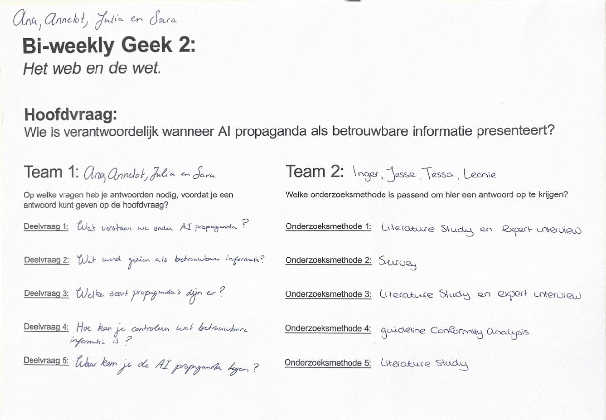

### Checkout

#### Wat bedoelt Vasilis met de uitspraak: Semantiek doet mij niet zo veel, ik ben liever bezig met de UX van HTML?

Dat hij liever bezig is met wat het doet dan met wat het betekent

#### Wat voor type beperkingen hebben invloed op het gebruiken van websites?

cognitief
motorisch
Visueel
Auditief

#### Noem drie manieren om door een website te navigeren met jouw screenreader.

Door naar de lijst te gaan met de koppen
Door alles voor te laten lezen en daarna selecteren.
Met de tab knop

### Deepdive - Meer interactie met HTML en CSS

Hier krijgen we wat meer basis uitleg maar ook wat uitleg over hoe je het beste forms in zijn max gebruik van kan maken.
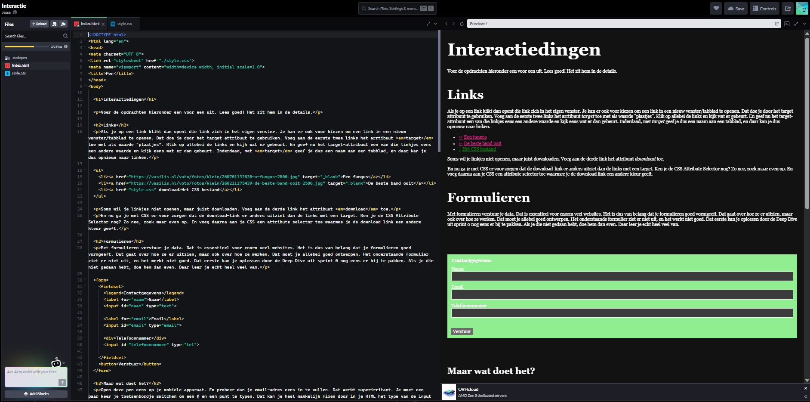

## Woensdag 30 sept - Sprint 2

### Proces

We hebben onze website gecheckt op of het toegankelijk is of niet. We gebruikte een stensel die alle punten nalopen. Waar je dus Yes/No op kan omcirkelen.

En ik kwam erachter dat ik nog wat dingen moest aanpassen zoals de kleuren van bepaalde teksten en de focusbox beter zichtbaar maken en dat ik alt aan mijn images moest toevoegen. en na de validator te gebruiken kwam ik er ook achter dat ik een paar errors had die ik moest fixen.

### Checkout

#### Waar staat WCAG en A11y voor?

Ze bevatten allebei allebei een checklist of het voldoet aan de AA eisen of niet. De ene is wat makkelijker te lezen dan de ander.

#### Wat vind je lastiger, je laptop/websites alleen met een toetsenbord bedienen of met een screenreader? Waarom? Waar moet je nog mee oefenen?

met een screenreader omdat het irritant is dat het alles voorleest dus ook tekst dus soms kom je op onnodige plekken terecht.

#### Met welke beperking rekening houden vind je het meest lastig?

Voor blinde mensen lijkt mij het lastigst

#### Vind je dat je beperkt wordt in wat je kunt ontwerpen? Of heb je al manieren gevonden om vanuit een solide basis  - die voor iedereen toegankelijk is - allemaal leuke en mooie extra's toe te voegen als je bezoekers dat goed vinden?

Soort van wel maar ik weet nu dat je met media query's manieren zijn hoe je het leuk kan houden voor alle doelgroepen.

## Vrijdag 2 okt - Sprint 2

### Retrospective

In mijn metafoor laat ik zien dat ik niet tevreden ben met wat ik bereikt heb omdat ik weet dat ik meer kan. Alleen ben ik ook inspiratieloos. Dat komt omdat ik het niet te moeilijk voor mezelf wil maken maar wel een soort uitdaging erin. Alleen vind ik de uitdaging al dat we geen classes mogen gebruiken tenzij het niet anders kan. Ik weet wel hoe ik het doolhof kan oplossen alleen wil ik een leuke uitdagende route hebben.

### Feedback

Ik ging op gesprek met Barbara en daaruit kwam dat ik:

Wat meer moet linken naar oude designs en de theorie die we leren.

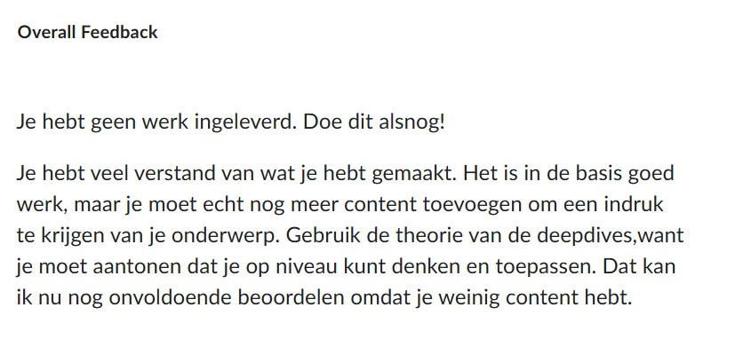
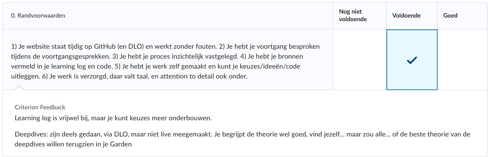
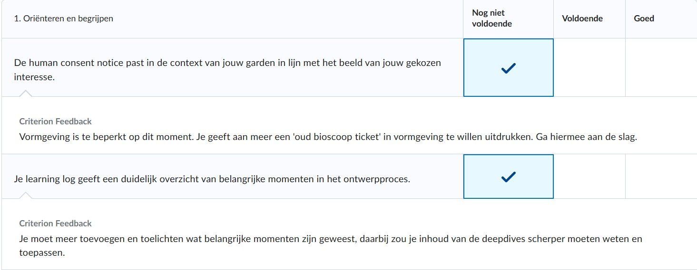
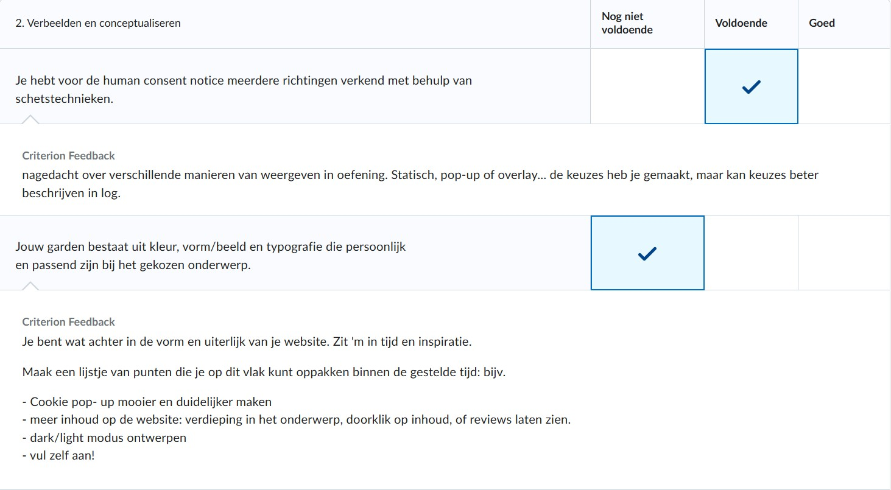
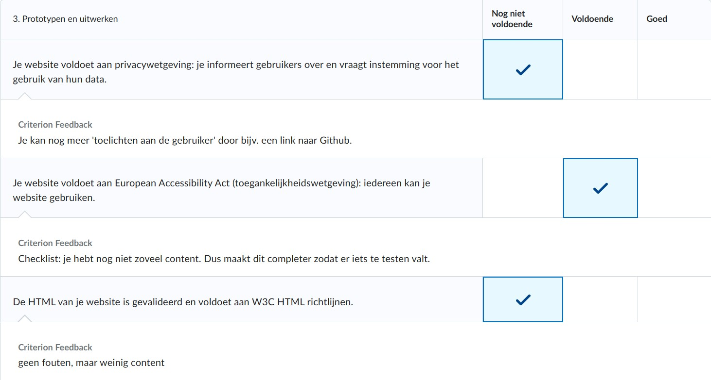
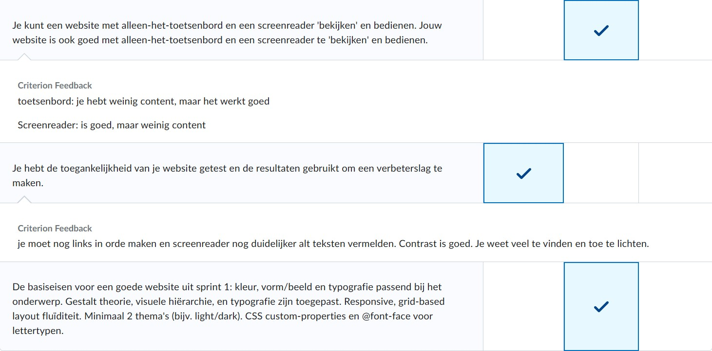

## Maandag 5 okt - Sprint 3

### Proces

Hier ging ik kijken hoe ik het in een mooie grid kon zetten maar al snel begreep ik dat ik minder elemten moest gebruiken want daardoor ging het zo opbreken in aparte kolommen en rijen.
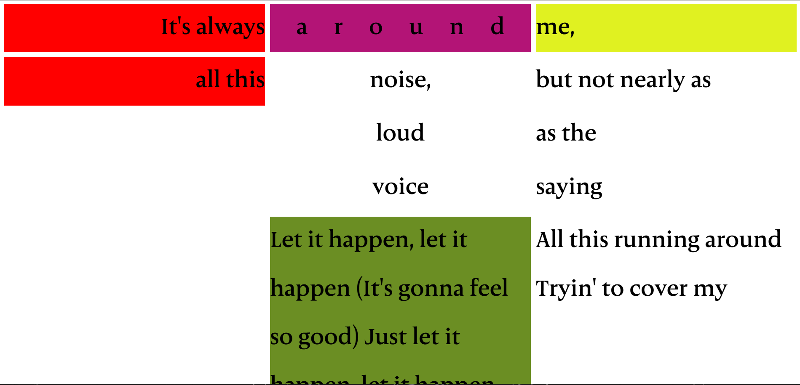

### Checkout

#### Leg uit wat er met de volgende termen bedoeld wordt: kerning, tracking, leading, flush-left, flush-right, centered, justified, indent, outdent, modular scale, movable type, focus punt, vijf soorten contrast, spatial tension. (Hint, alle termen staan in de artikelen die we samen gelezen hebben)

Kerning = De afstand tussen de letters van een woord wijzigen.
Tracking = Hetzelfde als kerning maar over een groter geheel.
Leading = Dat is de verticale ruimte van een tekst paragraaf wijzigen.
Flush-left = Is dat de tekst aligned is aan de linker kant.
Flush-right = Is dat de tekst aligned is aan de rechter kant.
Centered = Is dat de gehele tekst in het midden is uitgelijnt.
Justified = Dat de tekst verschillende witregels gebruiken om de uiteindes te alignen
Indent = Is de witregel die je creeërt met een tab-toets aan de begin van de zin.
Outdent = Het tegenovergestelde van Indent
Modular scale = Is een schaal die gebruikt wordt als vergrotende factor die kan helpen om koppen verschillende grotes te geven maar wel in harmonie met elkaar houden.
Movable type = is de stempels die gebruikt werden om een zin te printen. Ze werden naast elkaar gezet en dankzij dat ze allemaal dezelfde formaat blokjes hebben maakt het makkelijker om alles op formaat te doen en aligned.
Focus punt = is het punt dat het meest opvalt om de volgorde van de lezer te bepalen met wat ze als eerste zien.
Vijf soorten contrast = Je hebt 5 verschillende contrasten om bepaalde dingen op te laten vallen en een dynamisch effect te geven. Dat zijn de volgende 5: Size, Weight, Form, Structure and Color.
Spatial tension = is de witregels en de ruimte en de plaatsing van tekst die gebruikt wordt om een flowend gevoel te geven.

#### Wat is jouw ideale regellengte (measure)? Leg uit waarom.

tussen 45 characters en 75 characters, Omdat uit onderzoek is gebleken dat het de perfecte lengte is om snel te kunnen lezen. zonder dat je de draad kwijt raakt.

#### Als je in een ontwerp maar één variabele tot je beschikking had om hiërarchie aan te brengen (grootte, plaatsing, spacing, lettersoorten), welke zou je dan gebruiken en waarom?

Plaatsing want dat zorgt ervoor dat je een eigen lay-out eraan kan geven.

## Dinsdag 6 okt - Sprint 3

### Deepdive - Interessantere layouts

Ik heb tijdens deze deepdive gekeken naar hoe ik de titels een size kan geven die responsive zijn of een clamp hebben met daarin bijvoorbeeld een viewport en de clamp zorgt ervoor dat iets niet groter of kleiner word dan een waarde. en je een voorkeur hebt voor welke maat het wel moet zijn als dat lukt. Ik ga deze techniek zeker gebruiken voor alle soorten tekst omdat het heel handig is om het responsive te maken zonder te veel moeite.

Ik ga ook gebruik maken van de header verticaal plaatsen die als een sticky mee scrollt.

## Woensdag 7 okt - Sprint 3

### Deepdive - Variabele fonts

Ik heb de opdrachten gemaakt om te zien hoe variable fonts werken ik heb vooral gebruik gemaakt van wakamaifondue. Daarmee kan je zien hoe de fonts eruit zien met de font variation settings per waarde. Dat heb ik kunnen gebruiken voor mijn songtekst, want daar krijgen we als opgave om alleen de variable font Seraphs te gebruiken.

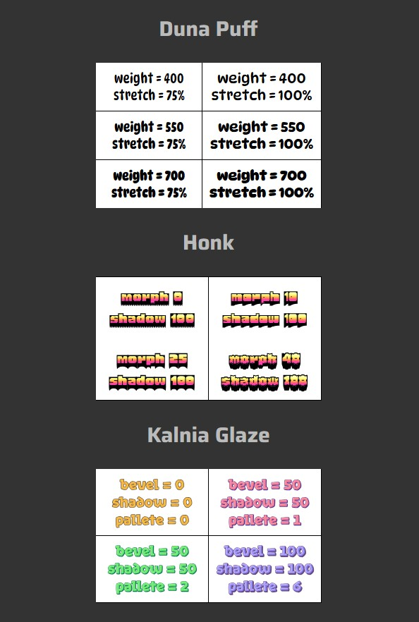

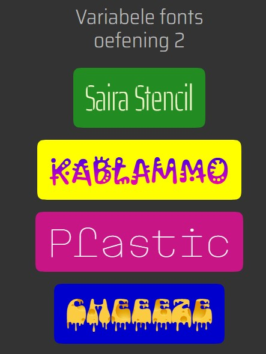

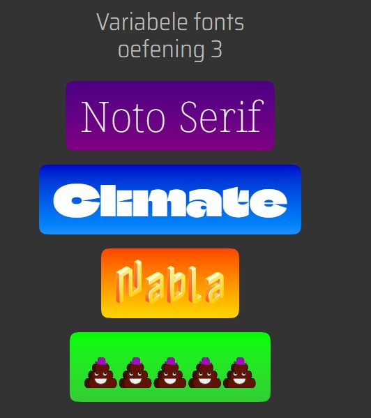

### Checkout

#### Waarom is het goed om een grid in je ontwerp toe te passen? Noem een reden voor de ontwerper en een voor de bezoeker.

Het is handig voor de ontwerpen om een hierarchie te creeëren maar ook onvoorspelbaar en responsive. Voor de bezoeker is het handig omdat de consistentie geen chaos veroozaakt maar juist overzichtelijkheid.

#### Noem drie manieren om chaos in je ontwerp te voorkomen.

1. Consistent zijn
2. Grid aanmaken
3. Stap voor stap werken.

#### Hoeveel gekkigheid moet er in je werk zitten?

Zoveel mogelijk, niks is te gek

## Vrijdag 9 okt - Sprint 3

### Proces

Ik heb eerst gekeken naar hoe ik het liedje kan onderscheiden. Dus vanaf welk moment komt er wat voor beatdrop en Zegt hij dingen hetzelfde. En welke emoties hoor ik op welke momenten. Daarna begon ik de gehele tekst te schetsen omdat ik dacht dat we de hele tekst moesten visualiseren uiteindelijk. Ik ben maar met 1 gehele schets gekomen. En daarna begon ik het gewoon in een grid te zetten en in sections te zetten. Ik heb veel kolommen en rijen gemaakt zodat ik veel kan variëren met de plaatsing ervan. Daarna gaf ik alle woorden die hetzelfde klonken dezelfde class. En de teksten die als refrein waren gaf ik een eigen element.
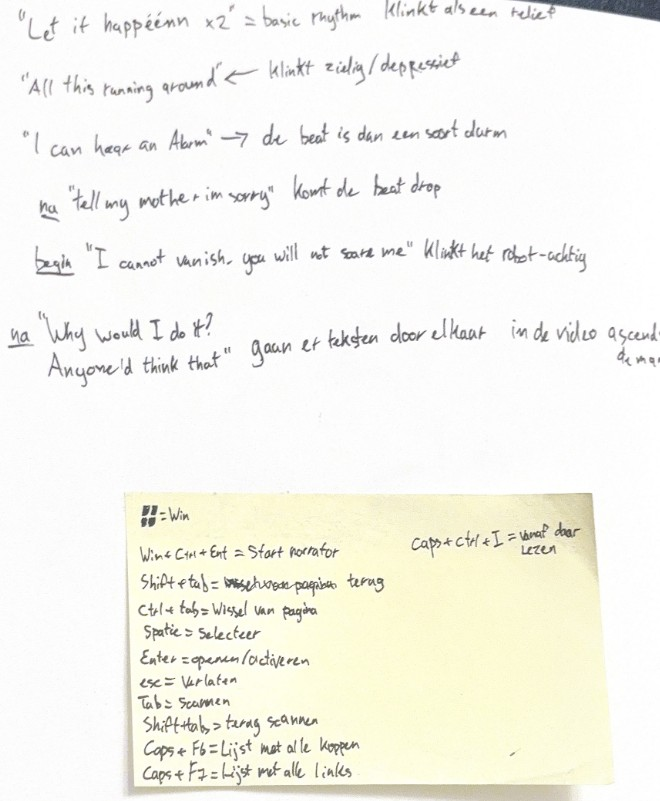
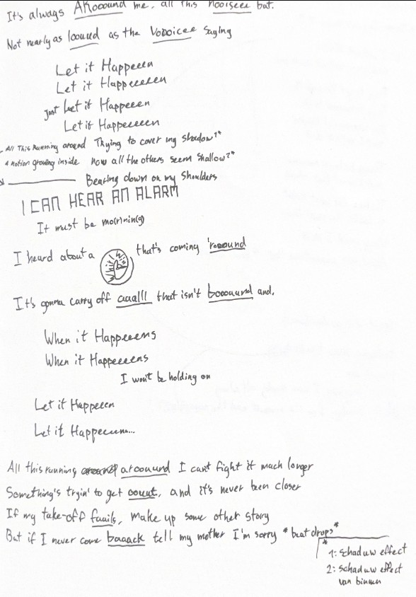
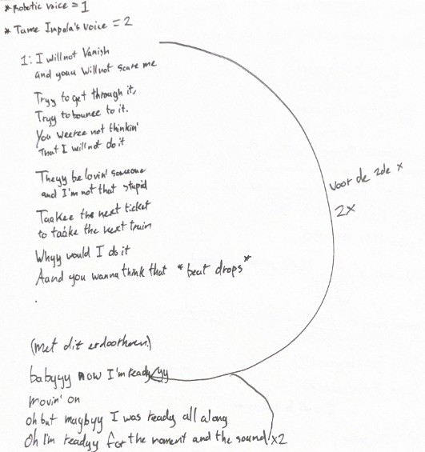
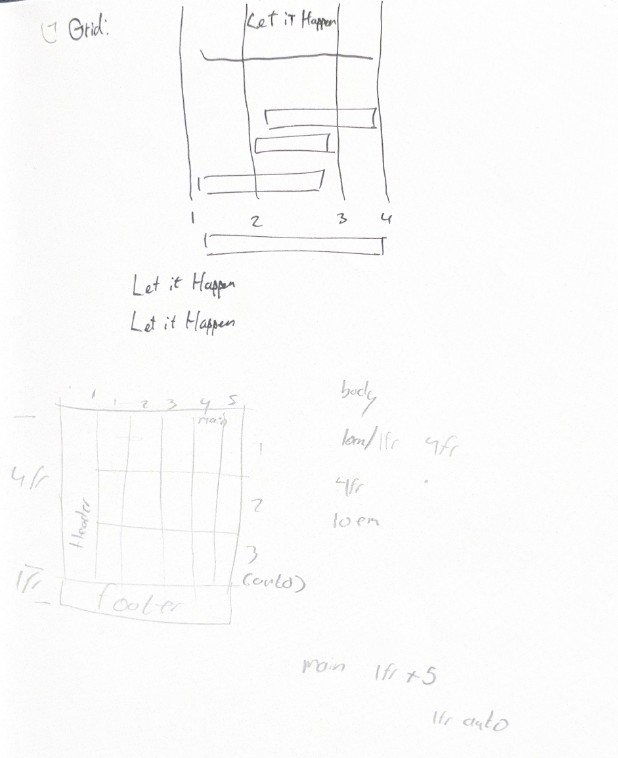

### Checkout

#### Welke variabelen van Seraphs gebruik je in de opmaak van je songtekst?
Ik gebruik de variabelen Weight en Serafs. Dus dan gaat het om de dikte van de tekst en om welke vorm de font krijgt. Ik gebruik deze property om het te benoemen: font-variation-settings: "wght" 150, "SRFS" 11;

#### Wat voegt iedere variabele toe aan je ontwerp (denk aan leesbaarheid, hiërarchie of de uitstraling die je wil bereiken)?
De Weight laat zien hoe luid iets gezegt wordt of hoe zacht maar ook hoe duidelijk je het wilt qua leesbaarheid, Vaak is de beste leesbaarheid ergens in het midden.

#### Hoe zou je animatie kunnen toepassen om het ritme of de accenten in de weergave van je songtekst nog beter visueel te maken?
Ik zou dus bij de gestrekte letters een soort ritme toevoegen door een delay per span letter te geven. Zodat ze niet allemaal tegelijk de animatie doen maar als een soort wave effect.

### Deepdive - CSS animaties

Ik heb niet veel gedaan aan deze deepdive maar dat is omdat mijn prioriteiten eerst nog elders liggen.

## Maandag 19 okt - Sprint 3

### Proces

Ik ben gaan kijken hoe webby ik mijn website vind en ik vind het zelf nog niet goed genoeg omdat ik weet dat ik het beter had kunnen doen als ik wat meer tijd erin had kunnen steken

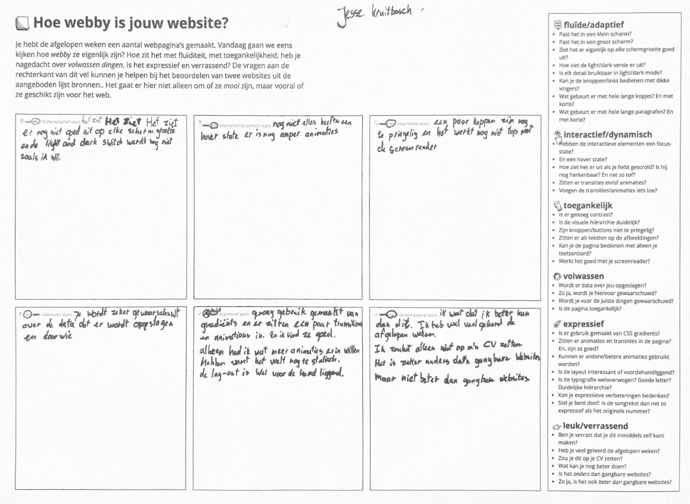

Ik ging samen met Joy kijken ernaar en zij kwam op deze punten uit:

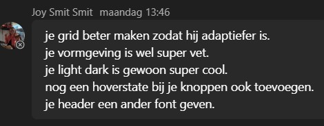

## Woensdag 21 okt - Sprint 3

### Bi-Weekly Geek

Dit keer moesten we nadenken over welke vragen je kan stellen om uiteindelijk een beter antwoord te kunnen geven op de hoofdvraag maar ook hoe je de vraag kan onderzoeken met welke onderzoekmethode.
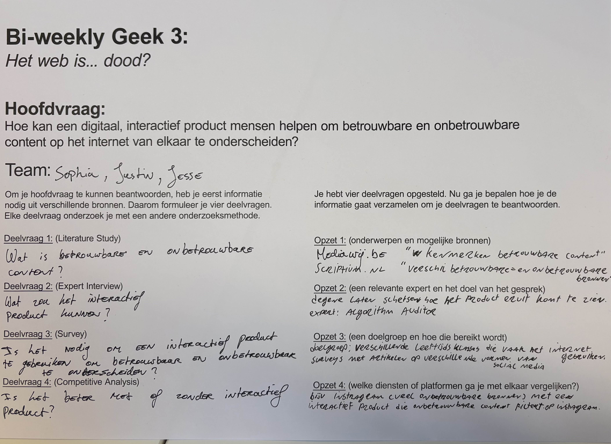

### Proces

Ik heb op basis van deze feedback wat dingen gefixt die ik zelf eerst niet door had. Maar heel makkelijk voor mij te fixen is. Dus dat is dan mooi meegenomen.
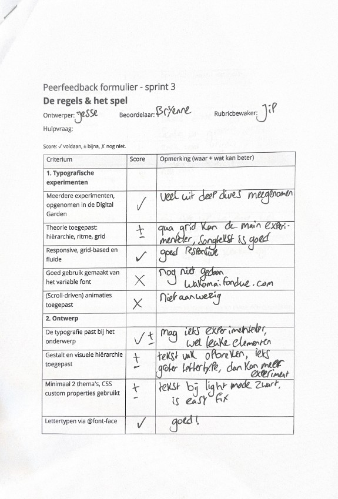
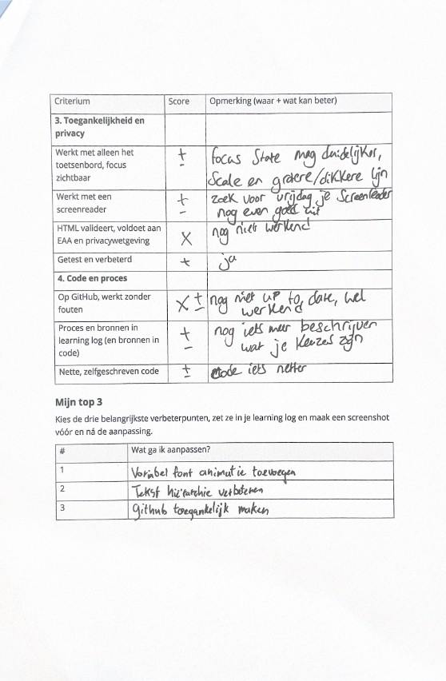

Ik heb een Light/Dark switch gemaakt geïnspireert door de broadway banners die je wel eens ziet bij broadway. dat leek me dus een leuk idee. En dankzij Sanne lukt het ook nog om de switch zelf te veranderen van svg foto.
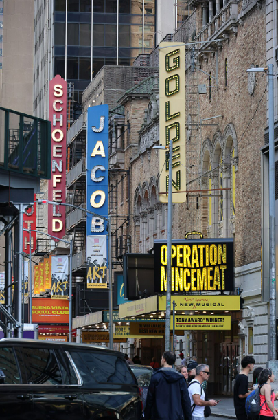
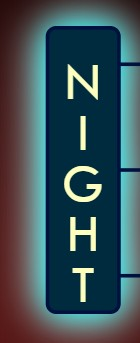

## Vrijdag 23 okt - Sprint 3

### Retrospective

Ik heb de retrospective gemaakt en het belangrijkste gedeelte vind ik wel een metafoor vinden dat ik kan tekenen dat toepasselijk is bij hoe deze sprint bij mij verliep vergeleken met de andere sprints. Maar dit keer moest het gaan over de gehele blok. Dus ik heb een pitstop getekent met een ranglijst waar ik laatste sta maar dankzij de HVC a.k.a. Herfst Vakantie Crew. Heb ik een inhaal slag kunnen maken en ben weer terug bij de race met de finish lijn in zicht.

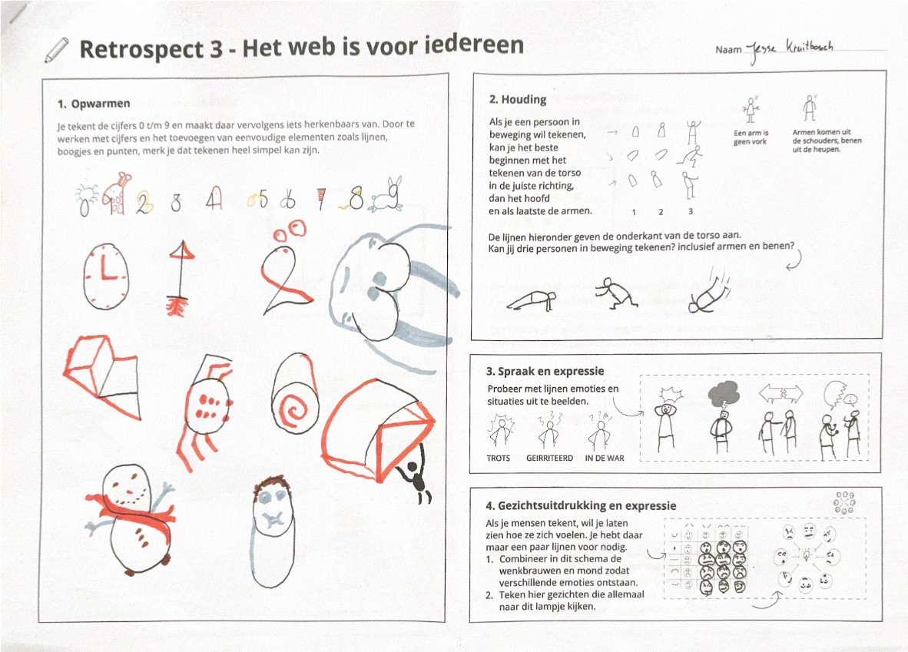
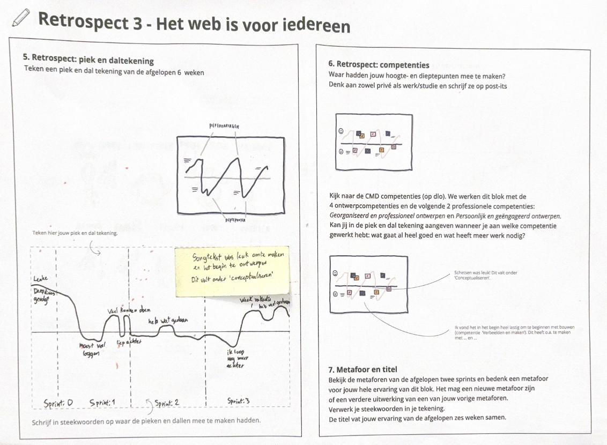
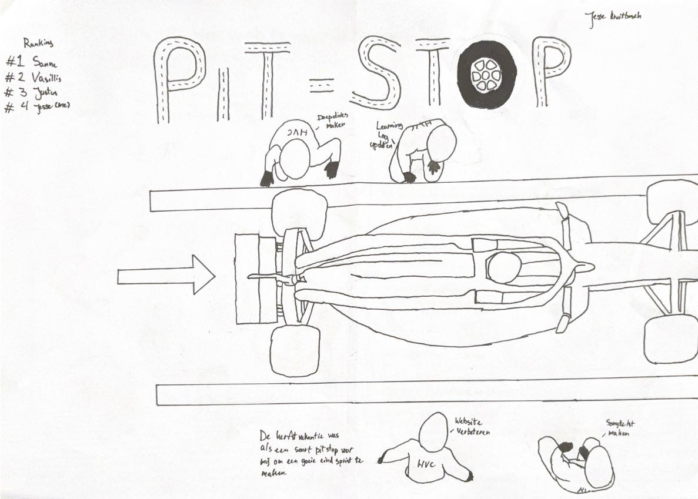

### Feedback

Vasilis: Learning log compeet maken en meer consistentie in witregels.

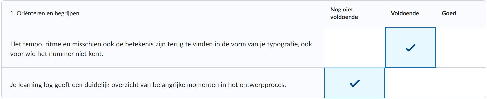
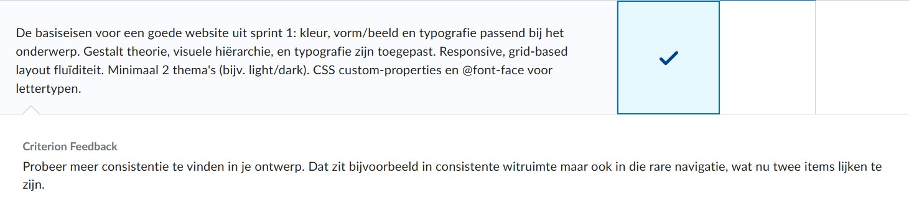

## Maandag 26 okt - Sprint 3

### Proces

We hebben een expo gehouden en we hebben elkaar beoordeelt aan de hand van stickers per categorie en ik heb veel positieve feedback gekregen en een verbeterpunt.
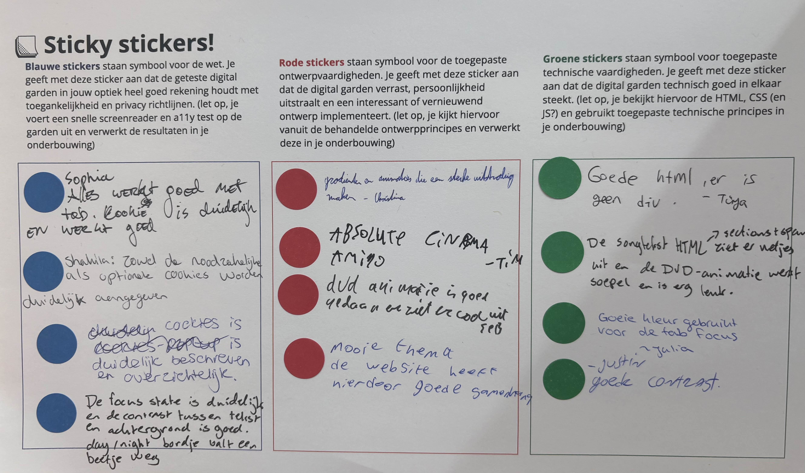

Ik heb weer gekeken of het webby genoeg is en op veel punten klopt het maar op een paar punten kan er nog wat verbetering in. Dus dat ga ik nog proberen aan te passen voor de deadline
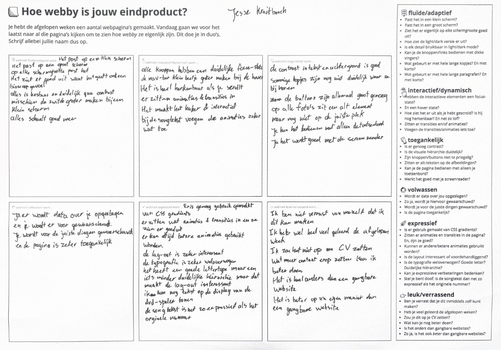

De learning log hebben we in groepjes vergeleken om te kijken hoe compleet van een ieder was. En ik merkte dat ik bij sommige dagen ben vergeten een foto van iets toe te voegen wat ik wel al gemaakt had. Dus ik ga het nog completer maken met behulp van de inzichten die ik heb gekregen na de vergelijkingen.

Ik heb alleen de stensel niet meer bij mij dus ik ga de antwoorden hier beantwoorden met behulp van de vragen die staan op DLO

#### 1. Is het Learning Log compleet? Loop hiervoor in DLO de sprints door en kijk waar onderdelen ontbreken. Leg de verschillende Learning Logs naast elkaar en vergelijk.
Ik mis een paar checkouts en een paar deepdives die ik niet helemaal heb gedaan maar voor de rest is het compleet. Behalve dan dat ik niet veel heb geschetst. en mijn proces van het ontwerp bij heb gehouden

#### 2. Zijn de drie visual-thinking opdrachten tijdens de retrospect uitgevoerd/opgenomen en wordt uit de tekeningen en het proces duidelijk hoe de student het blok ervaren heeft?
Alle drie de visual-thinking opdrachten zijn uitgevoerd en opgenomen. En ik vind zelf dat het een duidelijke metaforische beschrijving geeft hoe ik dit proces heb ervaren.

#### 3. Zijn de processen uit sprint 1, 2 en 3 navolgbaar? Denk hierbij aan visual research-schetsen-varianten voor de digital garden, de gekozen stijl en posters tijdens de online les, schetsen van de human consent notice en uiteindelijke uitwerking, schetsen en experimenten met typografie in sprint 3.
Niet helemaal naar mijn mening daar kon ik wat meer laten zien naar wat ik zelf gemaakt heb. Maar dat heb ik niet bijgehouden door screenshots te maken.

#### 4. Zijn schetsen vastgelegd en staat daar een omschrijving bij?
Er zijn niet veel schetsen vastgelegd maar overal is wel een kleine uitleg erbij. Ik heb niet veel schetsen omdat ik zelf niet zo van het schetsen bent. Terwijl mij wel meerder malen is verteld dat het handig is. (Ik ben eigenwijs)

#### 5. Zijn alle afbeeldingen goed gedraaid of staan afbeeldingen er verkeerd om in?
Alle afbeeldingen zijn goed gedraaid!

#### 6. Zijn alle bronnen vermeld?
Van de enige foto die ik gebruikt heb. Heb ik de bron ervan vermeld in mijn log

# Bronnen

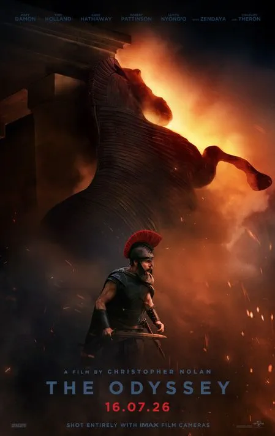
 
Bron 1: Vue Cinemas, https://www.vuecinemas.nl/film/the-odyssey